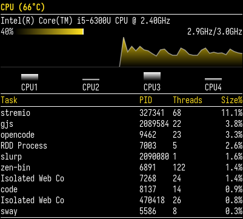
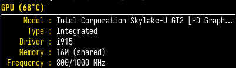
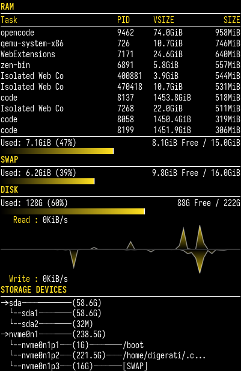
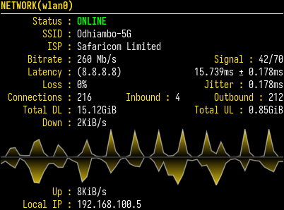
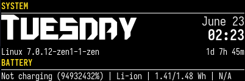
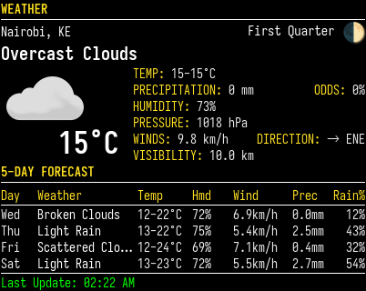
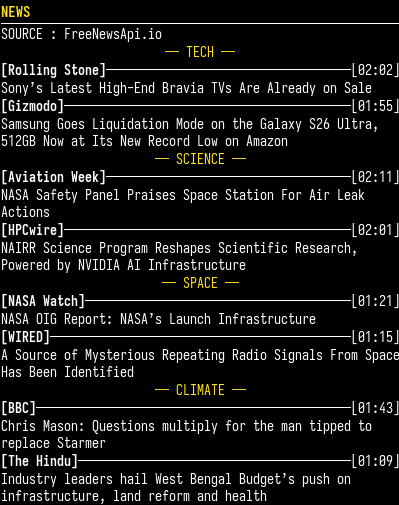
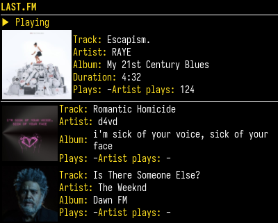
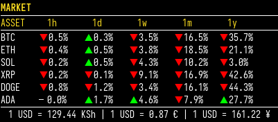
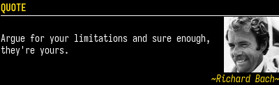

# AGS Overload Themes

A complete rebuild of the Conky Overload system monitor as an AGS v3 (Aylur's GTK Shell) configuration for modern Linux desktops.


## Available Widgets

### Overload — System Monitor

 
 
 

**Features:**

- Multi-core CPU monitoring with per-core gauges
- Memory, swap, and disk usage with live graphs
- GPU monitoring (AMD, NVIDIA, Intel)
- Network speeds, connections, SSID, bitrate, latency
- System info: kernel, uptime, battery, thermal zones
- Weather forecasts with 5-day outlook
- Dark yellow-on-black theme with Iosevka font
- Fully reactive — powered by gnim signals

---

### News — Headlines Widget



**Features:**

- Latest headlines from FreeNewsApi.io
- 5,000 requests/day limit
- Background fetching with reactive updates
- Published time display

---

### Last.fm — Music Display



**Features:**

- Real-time Last.fm integration
- Now-playing track display
- Personal play statistics
- Album artwork

---

### Market — Stock Ticker



**Features:**

- Real-time exchange rates
- Currency conversion display
- Powered by open.er-api.com

---

### Quote — Daily Inspiration



**Features:**

- Daily inspirational quotes from ZenQuotes.io
- 24-hour cache with disk persistence
- Instant startup

---

## Quick Start

```bash
git clone https://github.com/SethDigerati/ags-overload-themes.git
cd ags-overload-themes
ags run main.ts -g 4
```

### Widget Layout

Edit `config.ts` to arrange widgets between columns:

```ts
export const rightColumnWidgets = ["SystemBox", "CpuBox", "MemoryBox", "GpuBox"]
export const leftColumnWidgets = ["NetworkBox", "LastFmBox", "NewsBox"]
```

### API Credentials

Copy [.env.template](.env.template) to `.env` and set the required keys:

- `WEATHER_API_KEY` — for Weather widget
- `LASTFM_API_KEY` — for Last.fm widget
- `NEWS_API_KEY` — for News widget
- `ZENQUOTES_API_KEY` — for Quote widget

Do not commit your credentials.

## Requirements

- **Linux**
- **AGS v3** (Aylur's GTK Shell) with GJS/GTK4
- **gnim** reactive framework (bundled with AGS)
- **Iosevka** font (optional, falls back to monospace)
- **Smash Stadium Font** for weekday display (included in `assets/`)

### Install AGS

```bash
# Arch Linux
yay -S aylurs-gtk-shell-git

# Alternatively from source
git clone https://github.com/Aylur/ags.git
cd ags
npm run build
```

## Widget Comparison

| Widget       | Purpose             | Network | API Key | Poll Rate |
|--------------|---------------------|---------|---------|-----------|
| CPU          | System monitoring   | No      | No      | 1s        |
| GPU          | GPU stats           | No      | No      | 5s        |
| Memory       | RAM/Swap/Disk usage | No      | No      | 1s/30s    |
| Network      | Network monitoring  | Yes     | No      | 1s/5s     |
| System       | System info         | No      | No      | 5s        |
| Weather      | Weather forecast    | Yes     | Yes     | 4min      |
| News         | Headlines           | Yes     | Yes     | 5min      |
| Last.fm      | Music display       | Yes     | Yes     | 30s       |
| Market       | Exchange rates      | Yes     | No      | 4min      |
| Quote        | Daily inspiration   | Yes     | Yes     | 24h       |

## Repository Structure

```text
ags-overload-themes/
├── README.md
├── LICENSE
├── .env                     # API credentials
├── .env.template            # API credentials template
├── tsconfig.json            # TypeScript config
├── config.ts                # Widget layout & settings
├── data.ts                  # Polling logic & state
├── env.d.ts                 # TypeScript env declarations
├── main.ts                  # Entry point
├── style.css                # All widget styling
├── node_modules/            # AGS/gnim symlinks (required)
├── assets/
│   ├── screenshots/         # Widget screenshots
│   ├── icons/               # Weather & UI icons
│   └── Smash Stadium Font.ttf
└── src/
    ├── util.ts              # GLib helpers
    ├── ColumnWindows.tsx    # Column window setup
    ├── Levelbar.tsx         # Cairo levelbar component
    ├── Graph.tsx            # Cairo graph component
    ├── System.tsx           # System widget
    ├── Cpu.tsx              # CPU widget
    ├── Memory.tsx           # Memory widget
    ├── Gpu.tsx              # GPU widget
    ├── Network.tsx          # Network widget
    ├── Weather.tsx          # Weather widget
    ├── LastFm.tsx           # Last.fm widget
    ├── News.tsx             # News widget
    ├── Market.tsx           # Market widget
    └── Quote.tsx            # Quote widget
```

## License

This project is licensed under the **MIT License** — see the [LICENSE](LICENSE) file for details.

## Acknowledgments

- **[TeejeeTech](http://teejeetech.blogspot.in/)** — Original Conky Overload theme inspiration
- **[SethDigerati/conky-themes-repo](https://github.com/SethDigerati/conky-themes-repo)** — Original Conky implementation
